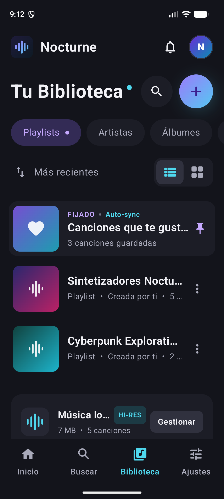
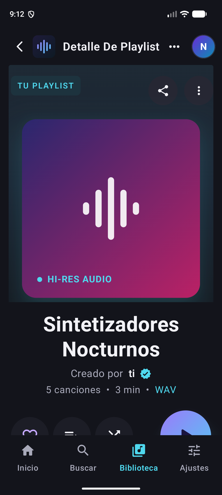
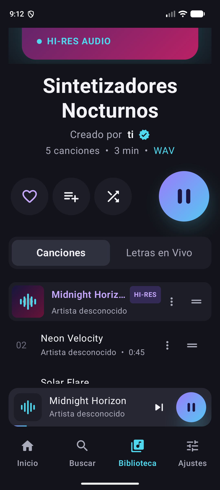
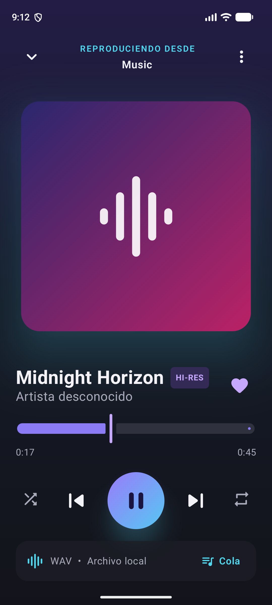
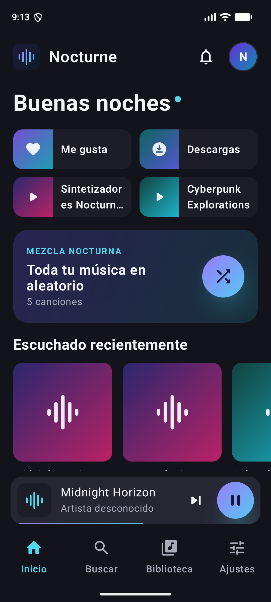
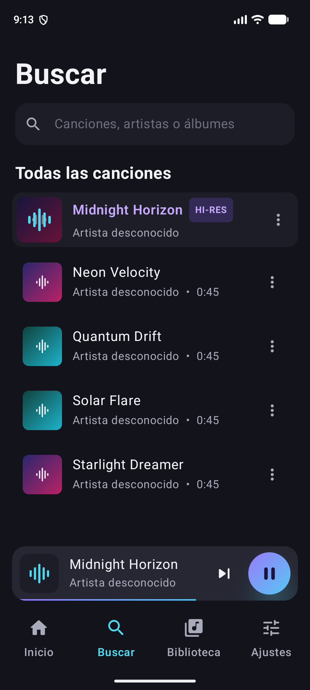
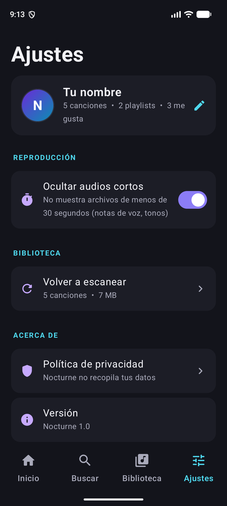

# 🎧 Nocturne — Reproductor de Música para Android

Reproductor de música **local** para Android con un diseño oscuro en tonos morado y cian.
Reproduce las canciones guardadas en el teléfono, sigue sonando en segundo plano con
controles en la notificación y permite organizar la música en playlists y favoritos.

Hecho con **Kotlin**, **Jetpack Compose** y **Media3 (ExoPlayer)**.

---

## 📸 Capturas

| Biblioteca | Detalle de playlist | Lista de canciones |
|:---:|:---:|:---:|
|  |  |  |

| Reproductor | Inicio | Buscar | Ajustes |
|:---:|:---:|:---:|:---:|
|  |  |  |  |

> Las capturas se tomaron en un emulador Pixel 7 con canciones de prueba generadas
> (por eso aparecen como "Artista desconocido" y sin carátula). Con música real se
> muestran el artista, el álbum y la carátula del archivo.

---

## ✨ Funciones

### Reproducción
- Reproduce MP3, FLAC, AAC/M4A, OGG/Opus y WAV guardados en el teléfono.
- **Sigue sonando en segundo plano**, con controles en la notificación y en la pantalla de bloqueo.
- Se **pausa sola al desconectar los audífonos** y respeta las llamadas y otras apps de audio.
- Aleatorio, repetir (todo / una), anterior / siguiente, barra de progreso y cola de reproducción.
- "Reproducir a continuación" y "Agregar a la cola" desde el menú ⋮ de cada canción.

### Biblioteca
- Pestañas **Playlists**, **Artistas**, **Álbumes** y **Descargas** (canciones de la carpeta *Download*).
- Orden por **Más recientes** o **A–Z**, y vista de **lista** o **cuadrícula**.
- **Canciones que te gustan**, siempre fijada arriba.
- **Playlists propias**: crear, renombrar, eliminar, agregar o quitar canciones y **reordenar arrastrando ☰**.
- Fijar álbumes y artistas en la biblioteca con el ♡.

### Pantallas
| Pantalla | Qué incluye |
|---|---|
| **Inicio** | Saludo según la hora, accesos rápidos, mezcla aleatoria, escuchado recientemente, álbumes nuevos y tus artistas |
| **Buscar** | Busca por canción, artista o álbum (ignora tildes y mayúsculas) |
| **Biblioteca** | Playlists, artistas, álbumes, descargas y espacio que ocupa tu música |
| **Detalle** | Portada con brillo, compartir, ♡, aleatorio, ▶️, pestañas *Canciones / Letras en Vivo* y calidad del archivo |
| **Reproductor** | Carátula grande, progreso, controles, ♡ y cola |
| **Ajustes** | Tu nombre, ocultar audios cortos (< 30 s), volver a escanear y política de privacidad |

### Privacidad
La app **no usa internet**, no tiene anuncios ni analíticas. Todo (playlists, favoritos,
historial) se guarda solo en el teléfono.

---

## 🛠️ Tecnologías

| | |
|---|---|
| Lenguaje | Kotlin |
| Interfaz | Jetpack Compose + Material 3 |
| Audio | AndroidX Media3 (ExoPlayer + MediaSession) |
| Datos | MediaStore (música del teléfono) y SharedPreferences (playlists y favoritos) |
| Android mínimo | 8.0 (API 26) · Target: API 37 |

## 📁 Estructura del proyecto

```
app/src/main/java/com/mimusica/app/
├── MainActivity.kt            # Permisos y arranque de la app
├── data/
│   ├── Song.kt                # Modelos: canción, álbum, artista, playlist
│   ├── MusicRepository.kt     # Lee la música del teléfono (MediaStore)
│   └── LibraryStore.kt        # Guarda favoritos, playlists, historial y ajustes
├── playback/
│   ├── PlaybackService.kt     # Servicio en segundo plano + notificación
│   └── PlayerController.kt    # Conecta la interfaz con el reproductor
└── ui/
    ├── NocturneApp.kt         # Navegación, mini reproductor y menús
    ├── theme/Theme.kt         # Colores y degradados de Nocturne
    ├── components/            # Botones, chips, filas de canción, carátulas...
    └── screens/               # Inicio, Buscar, Biblioteca, Detalle, Reproductor, Ajustes
herramientas/
└── generar_musica_prueba.py   # Crea canciones de prueba para el emulador
```

---

## 🚀 Cómo ejecutarlo

### Requisitos
- [Android Studio](https://developer.android.com/studio) (versión reciente).
- Un teléfono Android 8.0 o superior, o un emulador.

### Pasos
1. Clona el repositorio:
   ```bash
   git clone https://github.com/Victor-Gonzalo-Maldonado-Vilca/Reproductor_Musica.git
   ```
2. En Android Studio: **File → Open** y elige la carpeta `Reproductor_Musica`.
3. Espera a que termine **Gradle Sync** (la primera vez descarga las dependencias).
4. Elige tu teléfono o emulador arriba y pulsa **Run ▶️**.
5. En la app, toca **Permitir acceso** para que pueda leer tu música.

**En un teléfono real:** activa *Opciones de desarrollador → Depuración USB* y conéctalo por cable.

---

## 🧪 Cómo probarlo

### En un teléfono real
Si ya tienes música en el teléfono, aparecerá sola. Si no, copia algunos MP3 a la carpeta
**Música** o **Descargas** y luego, en la app, ve a **Ajustes → Volver a escanear**.

### En el emulador (sin música)
El emulador viene vacío. Genera canciones de prueba y cópialas así:

```bash
python herramientas/generar_musica_prueba.py musica_prueba
```
```bash
adb push musica_prueba/. /sdcard/Music/
```
```bash
adb shell content call --method scan_volume --uri content://media --arg external_primary
```

> También puedes arrastrar archivos de audio a la ventana del emulador; se guardan en *Download*.

### Lista de pruebas sugerida
- [ ] Al abrir por primera vez aparece la pantalla de bienvenida y se pide el permiso.
- [ ] **Biblioteca → Álbumes → un álbum → ▶️**: suena la música y la canción se resalta.
- [ ] Toca el **mini reproductor**: se abre el reproductor completo; prueba pausa, siguiente, aleatorio, repetir y mover la barra.
- [ ] **Bloquea la pantalla**: la música sigue y los controles aparecen en la pantalla de bloqueo.
- [ ] Baja la **barra de notificaciones**: están los controles de reproducción.
- [ ] Menú **⋮ de una canción → Agregar a Me gusta**: aparece en *Canciones que te gustan*.
- [ ] Botón **+** → crea una playlist → agrégale canciones → **reordénalas arrastrando ☰**.
- [ ] Renombra y elimina una playlist desde su menú ⋮.
- [ ] **Buscar**: escribe parte de un título o artista (con o sin tildes).
- [ ] **Ajustes**: cambia tu nombre (aparece en el avatar y en el saludo de Inicio).
- [ ] Cierra la app y vuelve a abrirla: tus playlists y favoritos siguen ahí.

### Compilar desde la terminal (opcional)
```bash
./gradlew assembleDebug
```
El APK queda en `app/build/outputs/apk/debug/app-debug.apk`.

---

## 📦 Publicar en Google Play (resumen)
1. **Build → Generate Signed App Bundle** en Android Studio y crea tu clave de firma
   (guárdala bien; **no la subas a GitHub**, el `.gitignore` ya la excluye).
2. Crea una cuenta en [Google Play Console](https://play.google.com/console) (pago único de 25 USD).
3. Sube el archivo `.aab`, las capturas de `docs/capturas`, la descripción y la
   **política de privacidad** (el texto está en *Ajustes → Política de privacidad*; publícalo en una página web).
4. Completa clasificación de contenido y seguridad de datos (la app no recopila datos).
5. Cuentas personales nuevas: prueba cerrada con 12 testers durante 14 días antes de producción.

---

## 🗺️ Ideas para próximas versiones
- Letras sincronizadas (archivos `.lrc`).
- Ecualizador.
- Temporizador para dormir.
- Widget en la pantalla de inicio.

## 👤 Autor
**Victor Gonzalo Maldonado Vilca**
